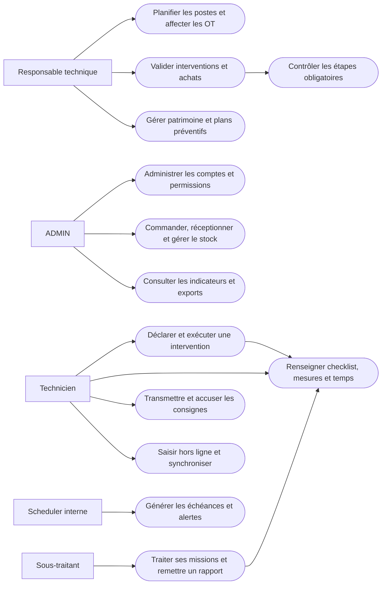
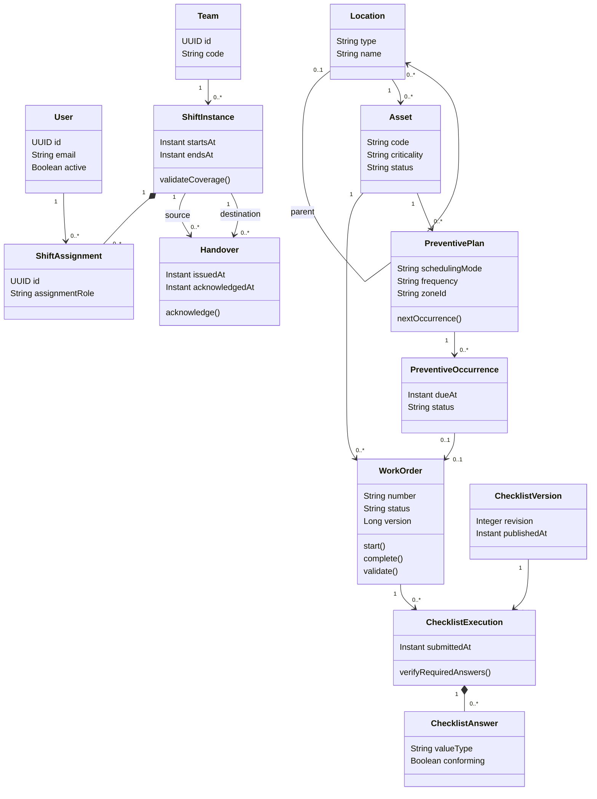
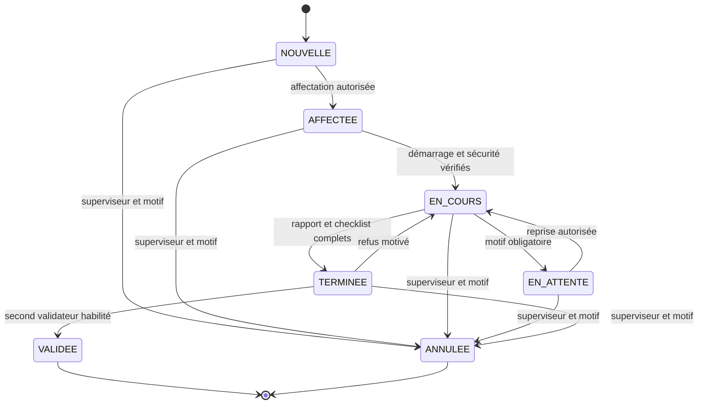
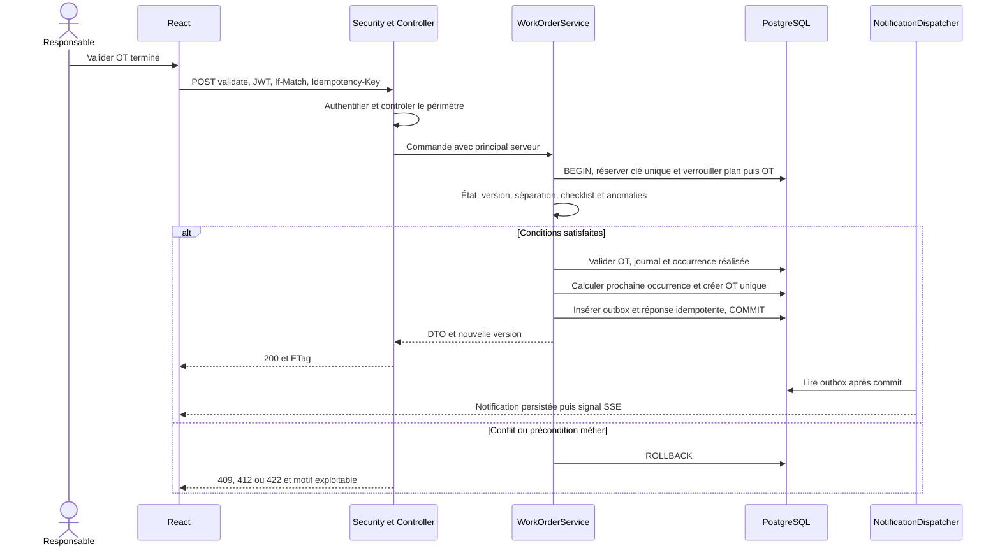
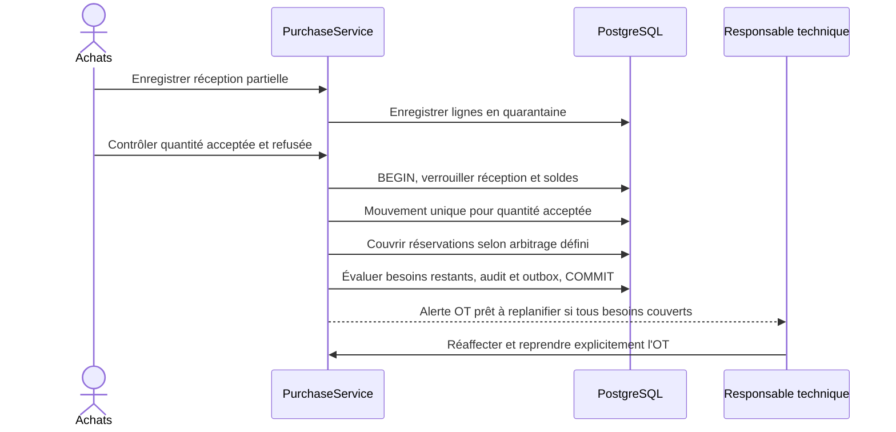
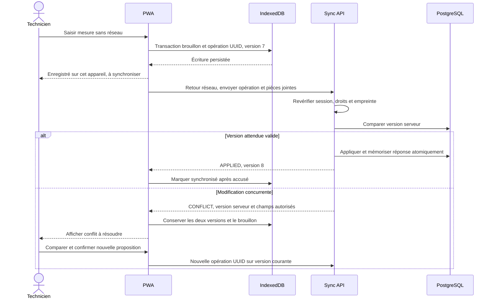

# Diagrammes UML

Le [diagramme de classes persistantes en PlantUML](../diagrammes/classes-persistantes.puml) décrit l’implémentation actuelle : 34 entités JPA, deux tables techniques sans entité JPA, leurs attributs et les associations définies par les clés étrangères Flyway. Il distingue les références UUID contraintes en base des références polymorphes et des documents JSONB.

Ces diagrammes décrivent la cible ; les décisions proposées sont détaillées dans le cahier des charges. Mermaid ne propose pas de notation native complète des cas d'utilisation : le premier diagramme représente les acteurs et leurs cas sous forme de graphe. Les autres utilisent les notations classe, états et séquence.

## Acteurs et cas d'utilisation

## Classes du noyau métier

Les relations de rôles, stocks, achats et documents sont détaillées dans le modèle de données. La cardinalité 0..* d'affectations représente aussi les postes encore incomplets ; la publication d'un planning déclenche le contrôle de couverture de 1 à 2 techniciens.

## États d'un ordre de travail

## Séquence : validation préventive concurrente

Un rejeu exact restitue la réponse persistée sans nouvelle transition. Tous les traitements utilisent le même ordre de verrouillage, y compris le scheduler. Une notification externe indisponible n'annule pas la validation.

## Séquence : réception de pièces

## Séquence : hors ligne et conflit

