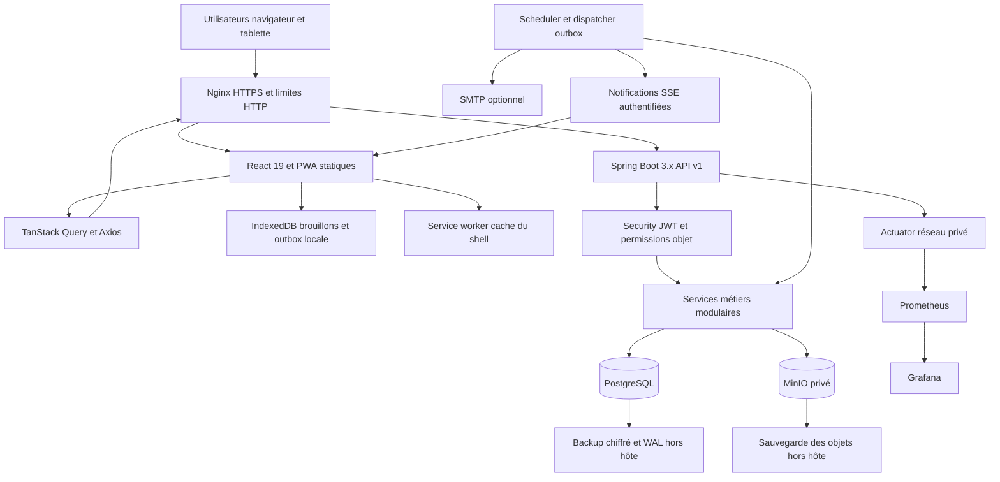

# Architecture technique et organisation

## Choix structurants

Un monolithe modulaire Spring Boot expose une API REST `/api/v1`, consommée par une SPA React et sa PWA. Ce choix conserve les transactions cohérentes entre OT, stock, achats et historique. Il évite de distribuer précocement les workflows ; les modules communiquent par services publics et événements internes, sans accéder directement aux repositories des autres modules.

Stack cible imposée : React 19+, TypeScript, Vite, Router, TanStack Query, Axios, React Hook Form et Zod, MUI, Recharts, i18next. Zustand peut porter les préférences et l'état de session ; les données serveur appartiennent à Query, les brouillons hors ligne à IndexedDB. Spring Boot 3.x, Java 21 LTS, Maven, Web, Data JPA/Hibernate, Security/JWT, Validation, Mail optionnel, Scheduling, Flyway, JUnit 5/Mockito et Springdoc. PostgreSQL 16 est la base de compatibilité proposée, cohérente avec le Compose existant.

Spring Boot 3.5 accepte Java 21 selon sa [documentation de compatibilité](https://docs.spring.io/spring-boot/3.5/system-requirements.html). La version exacte et son statut de maintenance devront être revérifiés avant implantation ; conserver la contrainte 3.x du brief et soumettre toute migration majeure à décision. Aucun changement de dépendance n'est effectué ici.

## Diagramme d'architecture



Le service worker sert les ressources du shell ; les réponses API authentifiées ne sont pas mises en cache aveuglément. Les données métier sélectionnées passent par IndexedDB avec partition par utilisateur et établissement.

## Organisation cible

Préserver le nom du projet existant. Proposition : garder la racine Java `tn.lamg.gmao` plutôt que renommer gratuitement tout le code en `com.polyclinique.gmao`. Cette différence avec l'exemple du brief est une décision de nommage à valider, sans effet métier.

```text
lamg-clinique-gmao/
  backend/
    src/main/java/tn/lamg/gmao/
      GmaoApplication.java
      config/       # web, Jackson, OpenAPI, temps, stockage
      security/     # JWT, session, principal, permissions
      common/       # identité, pagination, Clock, événements
      exception/    # ProblemDetail et erreurs métiers
      modules/
        auth/ users/ teams/ shifts/ handovers/ locations/ assets/
        preventive/ workorders/ checklists/ corrective/
        purchases/ inventory/ subcontractors/ notifications/ reports/
        files/ audit/ sync/
    src/main/resources/
      application.yml
      db/migration/ # Flyway après validation
    src/test/
    pom.xml
    Dockerfile
  frontend/
    src/
      app/          # providers, thème MUI, i18next, QueryClient
      components/   # champs, tables, confirmations, erreurs
      layouts/      # sidebar responsive, header, profil
      routes/       # routes protégées et contrôles de capacité
      features/
        auth/ dashboard/ users/ teams/ shifts/ handovers/ assets/
        maintenance/ checklists/ purchases/ inventory/
        subcontractors/ reports/ notifications/ sync/
      services/     # Axios, contrats DTO, IndexedDB
      hooks/ types/ utils/
    public/         # manifeste, icônes, shell hors ligne
    package.json
    Dockerfile
  infrastructure/
    nginx/ prometheus/ grafana/ backup/
  docs/
  docker-compose.yml
  .env.example
  README.md
```

Chaque module backend contient `controller/`, `service/`, `repository/`, `entity/`, `dto/`, `mapper/`. Les entités JPA ne sortent jamais directement de l'API. Les interfaces publiques des modules constituent les points d'intégration ; les DTO ne portent aucun secret ni information non autorisée.

| Module propriétaire | Responsabilité | Dépendances métier autorisées |
|---|---|---|
| auth/users | Comptes, rôles et sessions | security/common |
| teams/shifts | Compétences, postes et couverture | users |
| handovers | Transmission entre postes | shifts, références publiques OT/assets |
| locations/assets | Référentiel patrimonial | users pour droits, files |
| checklists | Versions et réponses typées | assets, files |
| workorders | Cycle, affectations, temps et validations | assets, shifts, checklists |
| preventive | Occurrences et création d'OT | workorders, assets, checklists |
| corrective | Déclaration et qualification des pannes | workorders, assets |
| inventory | Soldes, réservations et mouvements | références OT validées via interface publique |
| purchases | Demandes, commandes et réception | inventory, références publiques OT |
| subcontractors | Contrats et missions externes | users, workorders, files |
| reports | Projections et agrégats en lecture | projections autorisées des modules |
| notifications/audit | Événements et journal | common, sans rappeler les modules émetteurs |
| sync | Orchestration des commandes mobiles | services publics autorisés |

Pour éviter un cycle `workorders ↔ inventory`, les besoins en pièces sont possédés par inventory et consommés via un port de disponibilité défini par workorders ; une configuration relie l'adaptateur. De même, workorders publie `WorkOrderValidated`, preventive réagit dans la même transaction via une intégration explicite ; workorders ne dépend pas de preventive. L'outbox des notifications est enregistrée dans cette transaction, puis distribuée après commit.

## Authentification et protection

- Mot de passe haché BCrypt avec coût mesuré ; politique de longueur, vérification des tentatives et messages anti-énumération. Pas de mot de passe initial permanent dans le dépôt.
- JWT d'accès court (10 minutes proposé), conservé en mémoire du navigateur. Refresh token opaque aléatoire, empreinte uniquement côté serveur, cookie HttpOnly/Secure/SameSite, chemin limité à l'authentification. Rotation à chaque refresh, détection de réutilisation et révocation de la famille.
- Protection CSRF des routes utilisant le cookie (refresh/logout), vérification d'Origin, même origine privilégiée via Nginx ; CORS limité aux origines prévues en développement. Aucun token persistant dans localStorage.
- L'API vérifie signature, expiration, session active, compte actif et permissions effectives en base/cache court invalidé. Déconnexion et changement de rôles révoquent immédiatement la session. Un JWT signé ne suffit pas à préserver des privilèges révoqués.
- Refus par défaut ; contrôles de rôle ET d'appartenance établissement/équipe/mission ; filtrage avant pagination. Les guards React améliorent la navigation mais ne sont pas une barrière de sécurité.
- Réinitialisation : jeton aléatoire à usage unique, empreinte stockée, expiration 30 minutes proposée, réponse publique uniforme ; mot de passe changé → sessions révoquées.
- Logs sans mot de passe, token, URL signée ni contenu photo ; pièces privées en MinIO, types MIME contrôlés, limites de taille, analyse antivirus prévue et accès temporaire contrôlé. Aucun bucket public.

## Transactions et concurrence

`@Version` sur les agrégats modifiables et `ETag/If-Match` pour les écritures. Pour stock et occurrences, verrouillage pessimiste ciblé et contraintes d'unicité protègent les invariants. L'ordre de verrouillage est documenté : plan → OT → réception/ligne → soldes triés par identifiant ; les chemins qui n'utilisent qu'un sous-ensemble respectent cet ordre. Les opérations sont courtes, les appels SMTP/MinIO hors transaction SQL longue.

PostgreSQL décrit les [verrous de lignes et les risques d'interblocage](https://www.postgresql.org/docs/16/explicit-locking.html). Le choix de verrouillage ci-dessus est une proposition de conception : les deadlocks détectés devront faire l'objet de reprises bornées avec idempotence, jamais d'une boucle illimitée.

Une table outbox rend durables les notifications à diffuser. Livraison au moins une fois, déduplication par événement et destinataire, reprise exponentielle et alerte après échecs répétés. Le client recharge les notifications persistées si SSE est interrompu. Flux SSE via `fetch` authentifié, sans JWT dans l'URL ; renouvellement de session et reconnexion contrôlés.

## PWA et synchronisation

IndexedDB contient `assignedOrders`, `assetSnapshots`, `checklistVersions`, `drafts`, `attachments`, `pendingOperations`, `conflicts`, `syncCursor`. Écriture du brouillon et de l'opération dans la même transaction locale. Afficher quota, dernier succès et nombre d'opérations en attente ; ne pas annoncer un succès si la persistance locale échoue.

Pipeline : authentification → téléchargement des deltas autorisés → upload de fichiers → envoi ordonné des opérations par agrégat → accusé serveur → mise à jour locale → téléchargement des nouvelles versions. Les fichiers sont identifiés par UUID et empreinte ; leur rattachement à une réponse est contrôlé. Les uploads orphelins sont nettoyés après délai, sans supprimer les pièces validées.

Les opérations restent `PENDING`, `SENDING`, `APPLIED`, `CONFLICT` ou `REJECTED`. Après crash, `SENDING` revient à `PENDING`. Les commandes dépendantes restent bloquées jusqu'à résolution de l'opération précédente. Une session expirée suspend l'envoi jusqu'à reconnexion. Background Sync est une amélioration optionnelle ; une commande « Synchroniser » et la synchronisation au premier plan sont toujours disponibles.

Sur appareil partagé, séparation stricte des espaces utilisateurs ; avant déconnexion, proposer synchronisation ou export local protégé des saisies restantes, puis retrait des données de consultation. Sans accès à l'ancien compte, un autre utilisateur ne peut voir ses brouillons. Le chiffrement local et la politique d'appareils gérés doivent être étudiés ; IndexedDB n'offre pas à lui seul une protection contre un appareil compromis ou la suppression par le navigateur. Une saisie hors ligne ne doit pas être l'unique trace d'une situation critique : prévoir une consigne opérationnelle de secours.

## Déploiement et exploitation envisagés

Compose de développement : frontend statique servi par Nginx, backend, PostgreSQL, MinIO ; Prometheus/Grafana en profil monitoring. Redis non requis au départ : PostgreSQL porte l'idempotence, les sessions et les verrous. Les ports DB, MinIO, Actuator et Grafana ne sont pas exposés publiquement. Healthchecks distincts liveness/readiness ; readiness vérifie les dépendances essentielles.

Production : terminaison HTTPS, secrets injectés hors Git, comptes à privilèges minimaux, images figées et analysées, volumes persistants, journaux avec rotation, alertes exploitables. Plusieurs instances API demandent un scheduler à verrou partagé et des migrations exécutées une seule fois. L'hébergement redondant, les sauvegardes hors hôte et le plan de reprise constituent un chantier explicite ; Compose seul ne fournit pas de haute disponibilité.

Sauvegarde PostgreSQL avec archivage WAL pour la cible RPO, sauvegarde MinIO/versioning et métadonnées cohérentes, chiffrement et copie hors site. Test de restauration chronométré avant mise en service et périodiquement. Une sauvegarde présente mais non restaurable ne satisfait pas la recette.

Flyway gère toutes les évolutions après la reprise initiale. Le schéma applicatif est défini exclusivement par les migrations dans `backend/src/main/resources/db/migration/`. Pour reprendre une ancienne base, inventorier les données, produire une correspondance des identifiants, répéter la migration en préproduction et vérifier les comptages. Déploiements compatibles avec l'ancienne version pendant la transition ; pas de rollback destructeur de base.
