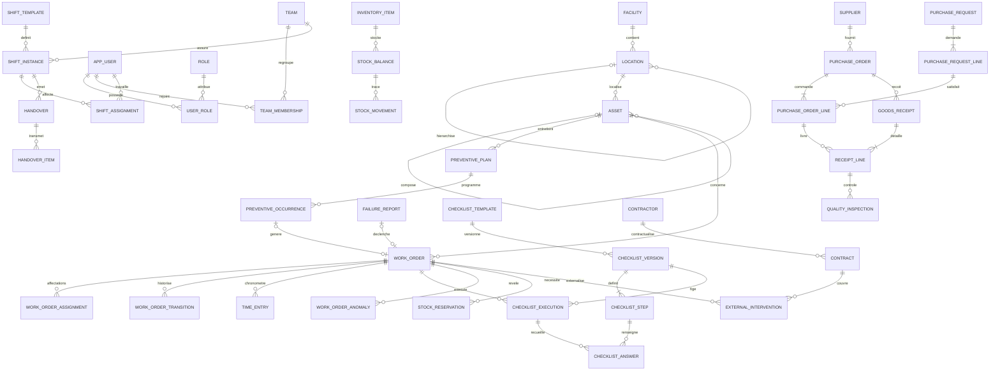

# Modèle de données et catalogue JPA

Ce document définit un schéma logique PostgreSQL de conception. Il ne s'agit pas d'une migration exécutable. La phase 2 transformera ce modèle validé en DDL Flyway, mappings JPA et tests d'intégrité.

## MCD

Le diagramme représente les relations principales. Les deux références de poste d'une consigne, les tables de compétences, de sécurité et de fichiers figurent dans le dictionnaire exhaustif ci-dessous. Une demande corrective non qualifiée peut ne pas avoir d'OT ; un OT correctif référence au plus une déclaration, et plusieurs déclarations similaires peuvent être regroupées par lien de doublon sans créer de nouveaux OT.

## Conventions du schéma relationnel

- Chaque table possède `id uuid PK`, sauf mention explicite d'une clé composée. Identifiants générés côté application, sans exposer des séquences comme autorisation. Les numéros humains sont des séquences métier uniques.
- `ref(table)` = `uuid NOT NULL REFERENCES table(id)` ; `ref?(table)` = même FK nullable. Toutes les FK sont indexées ; comportement `ON DELETE RESTRICT`, sauf tables purement transitoires explicitement purgées. Pas de suppression en cascade de l'historique.
- Types : `str(n)` = `varchar(n)`, `text`, `bool`, `int`, `bigint`, `num` = `numeric(14,3)` pour quantités, `money` = `numeric(16,3)` pour montants, `instant` = `timestamptz`, `date`, `time`, `jsonb`. `?` indique nullable ; les autres champs sont requis. Devise `char(3)` ; unité de mesure `str(24)`.
- **B** : chaque ligne porte aussi `created_at instant`, `created_by ref?(app_user)`. **M** : ajoute `updated_at instant`, `updated_by ref?(app_user)`, `version bigint NOT NULL DEFAULT 0`, mappée avec `@Version`. **A** : ajoute `archived_at instant?`. Les tables de journal sont B sans M, append-only.
- **F** : ajoute `facility_id ref(facility)`. Les références métier entre établissements différents sont interdites par clés uniques composites `(facility_id,id)` et FK composites correspondantes lorsque les deux tables sont F. Pour un enfant sans F, l'établissement est déduit du parent et les liens supplémentaires sont contrôlés de même.
- Dates d'événements et identité d'audit proviennent du serveur. Les valeurs d'état sont `varchar` avec contraintes `CHECK` et enums Java ; pas d'ordinal JPA. Les listes normatives d'états figurent dans le cahier des charges.

## Schéma relationnel

La colonne Entité donne la **liste complète des entités JPA proposées** pour ce périmètre. Chaque ligne correspond à une table et à une classe ; les objets embarqués de valeur et les DTO ne sont pas des entités. Les associations historisées ont une identité propre.

### Identité, établissement et personnel

| Table / entité JPA | Colonnes métier, en plus des conventions | Contraintes principales |
|---|---|---|
| `facility` / `Facility` BMA | code str(30), name str(160), zone_id str(64), currency char(3) | code unique ; fuseau IANA valide côté service |
| `app_user` / `User` FBMA | email str(254), password_hash str(255), display_name str(160), active bool, contractor_id ref?(contractor) | unique index sur lower(email) ; compte prestataire lié à une entreprise |
| `role` / `Role` B | code str(40), label str(100) | code unique, limité aux quatre rôles du brief |
| `user_role` / `UserRole` B | user_id ref(app_user), role_id ref(role) | unique(user_id,role_id) |
| `auth_session` / `AuthSession` B | user_id ref(app_user), family_id uuid, refresh_hash str(128), expires_at instant, revoked_at instant?, replaced_by_id ref?(auth_session), last_used_at instant? | refresh_hash unique ; famille indexée ; jeton en clair absent |
| `password_reset_token` / `PasswordResetToken` B | user_id ref(app_user), token_hash str(128), expires_at instant, used_at instant? | token_hash unique ; expiration et usage vérifiés atomiquement |
| `login_event` / `LoginEvent` FB | user_id ref?(app_user), attempted_identity_hash str(128), success bool, reason str(40), ip_address inet?, user_agent str(512)? | identité pseudonymisée, pas de mot de passe |
| `team` / `Team` FBMA | code str(20), name str(100) | unique(facility_id,code), A/B/C au démarrage |
| `team_membership` / `TeamMembership` B | team_id ref(team), user_id ref(app_user), valid_from date, valid_until date? | fin ≥ début ; périodes principales d'un utilisateur sans chevauchement |
| `skill` / `Skill` FBMA | code str(30), name str(120), safety_sensitive bool | unique(facility_id,code) |
| `user_skill` / `UserSkill` BM | user_id ref(app_user), skill_id ref(skill), valid_from date, valid_until date?, evidence_file_id ref?(stored_file) | unique(user_id,skill_id,valid_from), fin ≥ début |
| `absence` / `Absence` FBM | user_id ref(app_user), starts_at instant, ends_at instant, reason_code str(30), status str(24), approved_by ref?(app_user) | début < fin ; détail personnel restreint |
| `shift_template` / `ShiftTemplate` FBMA | code str(20), label str(80), starts_local time, ends_local time, end_day_offset int | unique(facility_id,code), offset 0 ou 1 ; durée calculée positive |
| `rotation_pattern` / `RotationPattern` FBMA | name str(100), anchor_date date, cycle_days int, rules jsonb, zone_id str(64) | cycle_days > 0 ; rules validé par DTO/version de format |
| `shift_instance` / `ShiftInstance` FBM | template_id ref(shift_template), team_id ref(team), rotation_id ref?(rotation_pattern), starts_at instant, ends_at instant, status str(24) | début < fin ; unique(facility_id,template_id,starts_at) ; une équipe affectée par poste |
| `shift_assignment` / `ShiftAssignment` BM | shift_id ref(shift_instance), user_id ref(app_user), starts_at instant, ends_at instant, replacement_for_id ref?(shift_assignment), approved_by ref?(app_user), exception_reason text? | unique(shift_id,user_id,starts_at), début < fin ; intervalle inclus dans le poste |
| `handover` / `Handover` FBM | from_shift_id ref(shift_instance), to_shift_id ref(shift_instance), priority str(8), comment text, issued_by ref(app_user), issued_at instant, acknowledged_by ref?(app_user), acknowledged_at instant?, addendum_to_id ref?(handover) | source ≠ destination ; accusé auteur/instant tous deux présents ou absents |
| `handover_item` / `HandoverItem` B | handover_id ref(handover), work_order_id ref?(work_order), asset_id ref?(asset), kind str(24), description text, priority str(8) | type OT, anomalie, surveillance ou note ; référence requise selon type |

### Patrimoine, préventif et exécution

| Table / entité JPA | Colonnes métier | Contraintes principales |
|---|---|---|
| `location` / `Location` FBMA | parent_id ref?(location), code str(40), name str(140), type str(24) | unique(facility_id,code) ; type BATIMENT/ETAGE/ZONE/LOCAL ; pas de cycle |
| `asset_category` / `AssetCategory` FBMA | code str(40), name str(120) | unique(facility_id,code) |
| `asset` / `Asset` FBMA | location_id ref(location), parent_id ref?(asset), category_id ref(asset_category), supplier_id ref?(supplier), code str(60), name str(160), brand str(100)?, model str(100)?, serial_number str(120)?, commissioned_on date?, warranty_until date?, criticality str(2), status str(24), qr_token uuid | code unique par établissement ; qr_token unique ; C1–C4 ; pas de cycle équipement |
| `asset_downtime` / `AssetDowntime` FBM | asset_id ref(asset), work_order_id ref?(work_order), starts_at instant, ends_at instant?, planned bool, reason text | fin ≥ début ; index asset/temps pour disponibilité |
| `checklist_template` / `ChecklistTemplate` FBMA | name str(160), asset_id ref?(asset), category_id ref?(asset_category), frequency str(24)?, description text? | modèle réutilisable ; portée explicite |
| `checklist_version` / `ChecklistVersion` B | template_id ref(checklist_template), revision int, state str(24), published_at instant?, published_by ref?(app_user) | unique(template_id,revision), revision > 0 ; publiée → immuable |
| `checklist_step` / `ChecklistStep` B | checklist_version_id ref(checklist_version), position int, label str(200), instruction text, field_type str(24), required bool, min_value num?, max_value num?, unit str(24)? | unique(version,position), position > 0, min ≤ max ; édition seulement version brouillon |
| `preventive_plan` / `PreventivePlan` FBMA | asset_id ref(asset), checklist_version_id ref(checklist_version), team_id ref?(team), name str(160), frequency str(24), interval_count int, mode str(16), anchor_local timestamp, zone_id str(64), anticipation_minutes int, active bool, next_due_at instant?, last_validated_at instant? | interval > 0 ; anticipation ≥ 0 ; FIXE/GLISSANT ; quotidien inclus |
| `plan_required_skill` / `PlanRequiredSkill` B | plan_id ref(preventive_plan), skill_id ref(skill) | unique(plan_id,skill_id) |
| `preventive_occurrence` / `PreventiveOccurrence` BM | plan_id ref(preventive_plan), sequence_no bigint, due_at instant, state str(24), reason text? | unique(plan_id,sequence_no), unique(plan_id,due_at) ; A_VENIR/EMISE/REALISEE/MANQUEE/ANNULEE |
| `failure_report` / `FailureReport` FBM | asset_id ref?(asset), location_id ref(location), reported_by ref(app_user), reported_at instant, description text, priority str(2), duplicate_of_id ref?(failure_report), state str(24) | équipement ou localisation qualifiée ; pas de cycle de doublons |
| `work_order` / `WorkOrder` FBM | number str(40), asset_id ref(asset), occurrence_id ref?(preventive_occurrence), failure_report_id ref?(failure_report), follow_up_of_id ref?(work_order), type str(20), status str(24), priority str(2), title str(180), description text, due_at instant?, scheduled_start instant?, scheduled_end instant?, started_at instant?, completed_at instant?, validated_at instant?, validated_by ref?(app_user), wait_reason str(24)?, wait_note text?, diagnostic text?, cause text?, solution text?, final_report text?, safety_checks jsonb, scheduling_ready bool | number unique par établissement ; occurrence/failure_report uniques si présentes ; P1–P4 ; statuts du cahier ; chronologie cohérente |
| `work_order_assignment` / `WorkOrderAssignment` BM | work_order_id ref(work_order), user_id ref?(app_user), team_id ref?(team), shift_id ref?(shift_instance), external_intervention_id ref?(external_intervention), starts_at instant, ends_at instant?, assigned_by ref(app_user) | au moins technicien ou équipe ou mission ; fin ≥ début ; une affectation principale active |
| `work_order_transition` / `WorkOrderTransition` B | work_order_id ref(work_order), from_status str(24), to_status str(24), actor_id ref(app_user), occurred_at instant, reason text? | append-only, transitions contrôlées par service |
| `time_entry` / `TimeEntry` BM | work_order_id ref(work_order), user_id ref(app_user), starts_at instant, ends_at instant?, break_minutes int, hourly_cost money?, currency char(3)? | fin > début, pause ≥ 0 et ≤ durée ; un chrono ouvert par utilisateur |
| `checklist_execution` / `ChecklistExecution` BM | work_order_id ref(work_order), checklist_version_id ref(checklist_version), performed_by ref?(app_user), submitted_at instant?, attested_at instant? | unique(work_order_id,checklist_version_id) ; version publiée |
| `checklist_answer` / `ChecklistAnswer` BM | execution_id ref(checklist_execution), step_id ref(checklist_step), bool_value bool?, numeric_value num?, text_value text?, conformity str(24)?, recorded_by ref(app_user), device_recorded_at instant?, recorded_at instant | unique(execution_id,step_id) ; valeur conforme au type ; étape appartenant à la version exécutée |
| `work_order_anomaly` / `WorkOrderAnomaly` BM | work_order_id ref(work_order), answer_id ref?(checklist_answer), description text, severity str(16), disposition text?, resolved_by ref?(app_user), resolved_at instant?, corrective_report_id ref?(failure_report) | résolution nominative ; une création corrective par demande idempotente |
| `measurement` / `Measurement` FB | asset_id ref(asset), work_order_id ref(work_order), answer_id ref?(checklist_answer), metric str(100), value num, unit str(24), min_snapshot num?, max_snapshot num?, out_of_range bool, recorded_by ref(app_user), measured_at instant | bornes figées ; answer_id unique si présent |

### Fournisseurs, achats, stocks et prestataires

| Table / entité JPA | Colonnes métier | Contraintes principales |
|---|---|---|
| `supplier` / `Supplier` FBMA | code str(40), name str(160), email str(254)?, phone str(40)?, address text? | unique(facility_id,code) |
| `inventory_item` / `InventoryItem` FBMA | code str(60), name str(180), unit str(24), minimum_qty num, reference_cost money, currency char(3), supplier_id ref?(supplier) | code unique par établissement ; seuil et coût ≥ 0 |
| `stock_location` / `StockLocation` FBMA | code str(40), name str(120), location_id ref?(location) | code unique par établissement |
| `stock_balance` / `StockBalance` BM | item_id ref(inventory_item), stock_location_id ref(stock_location), on_hand num, reserved num | unique(item_id,stock_location_id), 0 ≤ reserved ≤ on_hand |
| `stock_reservation` / `StockReservation` BM | work_order_id ref(work_order), item_id ref(inventory_item), balance_id ref?(stock_balance), requested_qty num, allocated_qty num, consumed_qty num, state str(24) | demandé > 0 ; 0 ≤ consommé ≤ alloué ≤ demandé ; couverture globale contrôlée |
| `purchase_request` / `PurchaseRequest` FBM | number str(40), work_order_id ref?(work_order), requested_by ref(app_user), justification text, status str(32), submitted_at instant?, approved_by ref?(app_user), approved_at instant?, decision_reason text? | number unique par établissement ; séparation demandeur/approbateur proposée |
| `purchase_request_line` / `PurchaseRequestLine` BM | request_id ref(purchase_request), item_id ref?(inventory_item), designation str(180), quantity num, unit str(24), reservation_id ref?(stock_reservation) | quantité > 0 ; article libre possible avant référencement |
| `purchase_order` / `PurchaseOrder` FBM | number str(40), supplier_id ref(supplier), status str(24), ordered_at instant?, expected_on date?, currency char(3) | number unique par établissement |
| `purchase_order_line` / `PurchaseOrderLine` BM | order_id ref(purchase_order), request_line_id ref(purchase_request_line), item_id ref(inventory_item), quantity num, unit_price money, tax_rate num | quantité > 0, prix ≥ 0, taxe 0–100 ; commandes fractionnées autorisées |
| `goods_receipt` / `GoodsReceipt` FBM | order_id ref(purchase_order), delivery_reference str(100), received_by ref(app_user), received_at instant, status str(24) | unique(order_id,delivery_reference) |
| `receipt_line` / `ReceiptLine` BM | receipt_id ref(goods_receipt), order_line_id ref(purchase_order_line), received_qty num | quantité > 0 ; ligne appartenant à la commande |
| `quality_inspection` / `QualityInspection` B | receipt_line_id ref(receipt_line), inspected_by ref(app_user), inspected_at instant, accepted_qty num, rejected_qty num, notes text, stock_location_id ref(stock_location) | valeurs ≥ 0 ; somme des contrôles ≤ reçu ; reliquat = quarantaine |
| `stock_movement` / `StockMovement` B | balance_id ref(stock_balance), work_order_id ref?(work_order), reservation_id ref?(stock_reservation), inspection_id ref?(quality_inspection), compensates_id ref?(stock_movement), kind str(24), quantity num, unit_cost money, currency char(3), reason text, operation_id uuid | quantité > 0 ; coût ≥ 0 ; operation_id unique ; entrée qualité unique par inspection ; IN/OUT/RETURN/ADJUST_IN/ADJUST_OUT |
| `contractor` / `Contractor` FBMA | code str(40), name str(160), email str(254)?, phone str(40)?, address text? | code unique par établissement |
| `contractor_skill` / `ContractorSkill` B | contractor_id ref(contractor), skill_id ref(skill) | unique(contractor_id,skill_id) |
| `contract` / `Contract` FBMA | contractor_id ref(contractor), reference str(80), starts_on date, ends_on date, scope text, amount money?, currency char(3)?, document_id ref?(stored_file) | référence unique par établissement ; début ≤ fin |
| `external_intervention` / `ExternalIntervention` FBM | contract_id ref(contract), work_order_id ref(work_order), planned_at instant?, visited_at instant?, internal_contact_id ref(app_user), report text?, cost money?, currency char(3)?, status str(24), approved_by ref?(app_user), approved_at instant? | visite dans contrat valide ou dérogation motivée ; coût ≥ 0 |
| `external_material_request` / `ExternalMaterialRequest` BM | intervention_id ref(external_intervention), designation str(180), quantity num, justification text, status str(24), purchase_request_id ref?(purchase_request) | quantité > 0 ; prestataire ne peut approuver sa demande |

### Fichiers et services transverses

| Table / entité JPA | Colonnes métier | Contraintes principales |
|---|---|---|
| `stored_file` / `StoredFile` FBM | object_key str(500), original_name str(255), mime_type str(120), byte_size bigint, sha256 str(64), status str(24), uploaded_by ref(app_user) | object_key unique, taille > 0 ; INIT/UPLOADED/SCANNED/REJECTED ; pas d'URL publique persistée |
| `attachment` / `Attachment` B | file_id ref(stored_file), asset_id ref?(asset), work_order_id ref?(work_order), answer_id ref?(checklist_answer), failure_report_id ref?(failure_report), intervention_id ref?(external_intervention), purpose str(24), title str(180), version_label str(30)? | exactement une cible non nulle ; FK réelles, pas de référence polymorphe sans intégrité |
| `notification` / `Notification` FBM | recipient_id ref(app_user), event_id uuid, type str(40), title str(180), resource_type str(40), resource_id uuid?, read_at instant? | unique(recipient_id,event_id,type) ; accès objet revérifié à l'ouverture |
| `outbox_event` / `OutboxEvent` FBM | aggregate_type str(40), aggregate_id uuid, event_type str(60), payload jsonb, occurred_at instant, published_at instant?, attempts int, next_attempt_at instant | attempts ≥ 0 ; payload minimal sans secret |
| `audit_event` / `AuditEvent` FB | actor_id ref?(app_user), session_id ref?(auth_session), actor_kind str(16), action str(80), resource_type str(40), resource_id uuid, before_version bigint?, after_version bigint?, changes jsonb, reason text?, correlation_id uuid | append-only ; acteur SYSTEM autorisé pour scheduler ; pas de secret dans changes |
| `idempotency_record` / `IdempotencyRecord` FB | user_id ref(app_user), operation_key uuid, route str(180), request_hash str(64), status str(16), response_status int?, response_body jsonb?, resource_id uuid?, expires_at instant | unique(user_id,operation_key) ; route et empreinte comparées avant rejeu |
| `sync_operation` / `SyncOperation` FBM | user_id ref(app_user), device_id uuid, operation_id uuid, resource_type str(40), resource_id uuid, expected_version bigint?, request_hash str(64), state str(24), error_code str(60)?, response jsonb? | unique(user_id,operation_id), lien logique vers clé idempotente identique |
| `sync_change` / `SyncChange` FB | sequence_no bigint, resource_type str(40), resource_id uuid, resource_version bigint, change_kind str(16), occurred_at instant | sequence_no unique, ordre monotone ; UPDATE/ARCHIVE/REVOKE, sans contenu sensible |
| `report_export` / `ReportExport` FBM | requested_by ref(app_user), report_type str(40), format str(8), filters jsonb, status str(24), file_id ref?(stored_file), expires_at instant, error_code str(60)? | PDF/XLSX ; téléchargement réservé au demandeur encore autorisé |

`report_export` matérialise les exports lourds ; les KPI sont des projections SQL, pas des entités artificielles. `sync_change` constitue un journal de deltas : le téléchargement recalcule les droits, transmet les retraits et détecte un curseur trop ancien. Il ne révèle pas les changements d'un autre périmètre.

## Contraintes et index complémentaires

1. Arbres : service transactionnel et trigger récursif prévus pour interdire les cycles ; transitions de type localisation autorisées uniquement suivant BATIMENT → ETAGE → ZONE → LOCAL, racine rattachée à facility. Un équipement doit appartenir à un LOCAL, sauf statut provisoire explicite à définir avant import.
2. Planning : extension PostgreSQL `btree_gist` envisagée et exclusion GiST sur `(user_id WITH =, tstzrange(starts_at,ends_at,'[)') WITH &&)` pour affectations actives ; contrôles d'absences et de repos dans le service sous verrou utilisateur. Même protection pour les postes d'une équipe. Publication bloque une couverture insuffisante, sauf dérogation motivée explicitement autorisée.
3. OT préventif : `occurrence_id UNIQUE` ; index unique partiel sur le plan dérivé nécessaire à la contrainte « un OT actif par plan ». Ajouter physiquement `preventive_plan_id ref?(preventive_plan)` à `work_order` pour cet index, avec FK composite `(preventive_plan_id,occurrence_id)` vers `(plan_id,id)` de `preventive_occurrence`, et contrôle des deux champs présents ensemble. Ce champ redondant est contrôlé par la base.
4. Index de travail : `work_order(facility_id,status,priority,due_at)`, `(asset_id,created_at DESC)`, affectations `(user_id,ends_at)` ; `preventive_plan(active,next_due_at)` ; `shift_instance(facility_id,starts_at)` ; `notification(recipient_id,read_at,created_at DESC)` ; `purchase_request(facility_id,status,created_at)`.
5. Index techniques : `outbox_event(next_attempt_at) WHERE published_at IS NULL`, `sync_change(facility_id,sequence_no)`, `audit_event(facility_id,resource_type,resource_id,created_at DESC)`, `stock_movement(balance_id,created_at DESC)` ; index d'expiration sessions/reset/idempotence. Indexer les FK composites de manière adaptée, sans doublonner systématiquement les index préfixés.
6. Stock : modifier solde, réservation et journal dans une transaction sous verrou des soldes. Unicité des entrées par inspection empêche le double crédit. Contrôle agrégé des réceptions sous verrou de la ligne de commande ; un simple CHECK de ligne ne peut pas assurer ce total interlignes.
7. Statuts : contraintes de champs locaux (VALIDEE exige validateur et instant, TERMINEE exige fin réelle, attente exige motif). Graphe de transitions, droits et cohérence entre tables contrôlés par services et tests d'intégration ; ne pas les présenter comme de simples CHECK SQL.
8. Unités/monnaies : pas de float pour coûts ou mesures ; conversion d'unité explicite ; précision définie par catalogue métier. Journaliser coût et devise historiques ; ne pas recalculer les anciens coûts avec les prix actuels.
9. Rétention : métadonnées d'archives et journaux conservés suivant politique validée. Ne pas purger l'idempotence avant la durée maximale de réémission des mobiles ; proposition de 90 jours, puis refus explicite des opérations trop anciennes plutôt que réexécution silencieuse.
10. Documents : `stored_file` n'est effacé que s'il n'est plus référencé, après délai validé ; contrôle du fichier en quarantaine avant rattachement exploitable. Les FK utilisateur historiques empêchent une suppression destructive ; pseudonymisation étudiée séparément.

## Reprise de l'existant

Le modèle cible ajoute des UUID et des FK à la place des noms d'acteurs libres. Conserver une table de correspondance d'import des anciens identifiants ; ne pas convertir une chaîne `verified_by` en compte réel sans preuve. Les dates historiques `timestamp` ne deviennent `timestamptz` qu'après confirmation du fuseau d'origine.

Les statuts `OPEN`, `PENDING_VERIFICATION`, `CLOSED`, `WAITING_PARTS` devront être rapprochés respectivement de `NOUVELLE`, `TERMINEE`, `VALIDEE`, `EN_ATTENTE` avec contrôle des données. `HANDOVER` devient une relation de consigne, pas un statut d'exécution. `READY_TO_SCHEDULE` devient un indicateur de disponibilité des pièces. Aucun script de transformation ne sera exécuté avant inventaire et validation.
